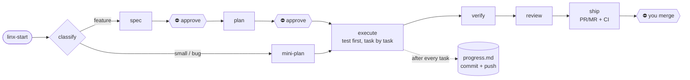

<div align="center">

# linx

**A disciplined SDLC for AI coding agents, in any repository.**

Spec → plan → test-first execution → verify → review → ship, with you approving every step that matters.
Works with **Claude Code**, **Cursor** and **Codex**, on **GitHub** and **GitLab**.

[](https://github.com/hublinx/linx/actions/workflows/ci.yml)
[](https://github.com/hublinx/linx/releases)
[](LICENSE)
[](package.json)


[Quick start](#quick-start) · [How it works](#how-it-works) · [Install](#install) ·
[Stacks](#supported-stacks) · [GitHub & GitLab](#github--gitlab) · [FAQ](#faq)

</div>

---

## Why linx

AI coding agents are fast, but left alone they:

- start coding before anyone agreed on **what** to build;
- say "done" **without running** the type checker or the tests;
- **lose track** of half-finished work when you switch tools, run out of quota or clear the context;
- change auth, money or database code **without asking** first.

linx is a set of agent skills plus a small, dependency-free toolkit that fixes this with a workflow you can
read, configure and audit:

| | |
|---|---|
| 🧭 **Spec and plan before code** | Features go through a written spec and a task-by-task plan. ⛔ The agent waits for your approval at each one. |
| ✅ **A real verify gate** | `node .linx/verify.mjs` runs your typecheck, lint, tests and build and prints one line: `verify: PASS 4/4 in 83s`. No PASS, no "done". |
| 📉 **Baselines for legacy code** | Existing tsc, eslint, ruff and .NET warnings are recorded once; only **new** ones fail. Adopt it on day one. |
| 💾 **Resume anywhere** | Work state lives in `spec.md`, `plan.md` and `progress.md`, committed after every task. Switch Claude Code ↔ Cursor ↔ Codex, or change machines, then say `linx-resume`. |
| 🛑 **Knows when to stop** | Schema, auth, money, shared API contracts, multi-repo changes (configurable) force the full track and an explicit stop-and-ask. |
| 🔁 **GitHub & GitLab loop** | Issue → spec → PR/MR with `Closes #123` → wait for CI → read failed logs and fix → work through review threads. The agent never merges. |
| 📚 **Project knowledge** | `linx-learn` writes domain docs (business rules with `file:line`) that agents read before touching code. |
| 💸 **Token-aware** | A cheap model searches, a mid-size model implements, the strongest model writes specs, plans and reviews. |

## Quick start

```bash
cd your-project
npx -y github:hublinx/linx init --ci      # skills, config, verify gate, CI, PR/MR template
node .linx/verify.mjs                     # see the gate run
```

Then tell your agent what you want, for example *"Add CSV export to the orders page"*. It starts with
`linx-start` on its own.

Using Claude Code? Install the plugin instead. See [Install](#install).

## How it works



A session looks like this:

```text
You:   Add CSV export to the orders list, filterable by date range.
Agent: (linx-start) Feature: it touches a shared API contract. → linx-spec, one question at a time …
       spec.md written and committed. Please review. ⛔
You:   Approved.
Agent: (linx-plan) 6 tasks, each with a test and a verify command. Run with subagents or inline? ⛔
You:   Subagents.
Agent: (linx-execute) T1 … T6 done — test first, verify: PASS, commit, progress.md updated after each.
Agent: (linx-ship) verify: PASS 4/4 in 91s · review clean · PR opened: <link> · CI green. Merge is yours. ⛔
```

Other ways in:
- *"linx-start #123"*: the issue becomes the requirements.
- *"handle the PR comments"*: the agent works through unresolved review threads.
- *"linx-resume"*: pick up where the last session, tool or machine stopped.

### The skills

| Skill | When it runs |
|---|---|
| `linx-start` | First, for every task: loads context, reads the issue if any, classifies small vs feature, routes |
| `linx-spec` | Feature: clarify → options → design → `spec.md` ⛔ |
| `linx-plan` | Approved spec → small tasks, each with a test and a verify command → `plan.md`, `progress.md` ⛔ |
| `linx-execute` | Each task: test first → implement → verify → commit → update progress → push |
| `linx-verify` | Before any "done": run the gate, record the `verify:` line |
| `linx-review` | Checklist review (auth, contracts, money, data, security, performance, tests + your items); PR/MR feedback |
| `linx-ship` | Knowledge update → PR/MR → wait for CI, fix failures → you merge ⛔ |
| `linx-resume` | Continue unfinished work after switching tool, machine or context |
| `linx-debug` | Bugs: reproduce → failing test → root cause → fix |
| `linx-learn` | Write or refresh a domain doc from the code |
| `linx-init` | Set up or update linx in a project |

Plus three Claude Code subagents: `linx-explorer` (haiku, search), `linx-implementer` (sonnet, one plan task)
and `linx-reviewer` (opus, clean-context review).

## Install

Every option is per project. Project settings live in `.linx/config.json`, which you own.

### Claude Code plugin

```text
/plugin marketplace add hublinx/linx
/plugin install linx@linx
```

Then, in each project, say *"use linx-init"*. The agent previews the setup, installs the project files and tunes
the config with you. Skills, agents and hooks come from the plugin.

### CLI: Claude Code, Cursor, Codex

```bash
npx -y github:hublinx/linx init                # Claude Code + whatever the repo already uses
npx -y github:hublinx/linx init --tools=all    # .claude/, .cursor/ and .agents/ (Codex & others)
npx -y github:hublinx/linx init --ci           # also generate CI (GitHub Actions / GitLab CI)
```

Skills are copied into the repo, so everyone who clones it gets the same workflow with nothing to install.
Pin a version with `github:hublinx/linx#v0.3.0`.

### Skills only

`skills/` follows the standard Agent Skills layout, so `npx skills add hublinx/linx` works as well. Run
`linx init` afterwards for the config, verify gate and AGENTS.md section.

### Supported agents

| | Claude Code | Cursor | Codex & others |
|---|---|---|---|
| Skills | `.claude/skills` or plugin | `.cursor/skills` | `.agents/skills` |
| Always-on instructions | `AGENTS.md` via `CLAUDE.md` + session hook | `AGENTS.md` + `.cursor/rules/linx.mdc` | `AGENTS.md` |
| Subagents (parallel tasks, clean review) | ✅ | runs inline | runs inline |
| Format + sensitive-file hook after edits | ✅ | — | — |

## Supported stacks

The workflow (skills, work state, review, GitHub/GitLab) is language-agnostic: the agent runs the commands in
`.linx/config.json`. `init` detects and sets up:

| Stack | Detected from | Verify steps | Baseline | Format after edit | CI toolchain (`--ci`) |
|---|---|---|---|---|---|
| **.NET** (C#, F#, VB) | `*.sln`, `*.slnx`, `*.csproj`, `*.fsproj`, `*.vbproj` | `dotnet build`, `dotnet format --verify-no-changes`, `dotnet test` | ✅ warnings, errors, format issues | `dotnet format whitespace` | `setup-dotnet` · `dotnet/sdk` image |
| **Node / TypeScript** | `package.json` | `tsc`, `eslint`, `test` and `build` scripts | ✅ tsc, eslint | prettier | `setup-node` · `node` image |
| **Python** | `pyproject.toml`, `requirements*.txt` | ruff, mypy, pytest | ✅ ruff | `ruff format` | add your setup step |
| **Go** | `go.mod` | `go vet`, `go test`, `go build` | — | `gofmt` | add your setup step |
| **Rust** | `Cargo.toml` | `cargo clippy`, `cargo test` | — | `rustfmt` | add your setup step |
| **Java** | `pom.xml`, `gradlew` | `mvn verify`, `./gradlew check` | — | — | add your setup step |
| **Anything else** | — | your commands | — | your formatter | add your setup step |

<details>
<summary><b>.NET details</b></summary>

- **SDK version:** from `global.json`, else the highest `<TargetFramework(s)>`, else `8.0`.
- **Build target:** the root solution, else the root project, else the only project in the tree. Several
  projects without a solution → you list the steps yourself.
- **Build:** runs with `--no-incremental`. An incremental build skips up-to-date projects and would undercount
  warnings.
- **Legacy warnings and format issues:** run `node .linx/verify.mjs --update-baseline` once; from then on only
  new ones fail.
- **GitLab CI:** the SDK image installs Node with `apt` so the verify gate can run.

</details>

<details>
<summary><b>Example: Ruby, configured by hand</b></summary>

```json
"verify": [
  { "name": "lint", "cmd": "bundle exec rubocop" },
  { "name": "test", "cmd": "bundle exec rspec" }
],
"format": { "command": "bundle exec rubocop -a {file}", "extensions": [".rb"] }
```

</details>

## Verify gate

```console
$ node .linx/verify.mjs
✔ typecheck (21s)
✘ lint (9s)
New errors vs baseline:
src/orders/export.ts: 0 → 2
✔ test (38s)
✔ build (15s)
verify: FAIL 3/4 (failed: lint) in 83s
```

```bash
node .linx/verify.mjs --only=typecheck,lint   # just these steps
node .linx/verify.mjs --only=e2e              # opt-in steps ("default": false)
node .linx/verify.mjs --update-baseline       # record today's errors; only new ones fail from now on
```

Agents record just the summary line in `progress.md` and in the PR/MR description, never the full log. They
are told never to update the baseline to get past the gate.

## GitHub & GitLab

`.linx/forge.mjs` gives the agent one set of commands for both forges. It wraps the official CLIs (`gh`,
`glab`), so it works with self-hosted GitLab and GitHub Enterprise too. You only need to install the CLI and log
in.

| Command | What the agent uses it for |
|---|---|
| `info` | Is the CLI installed and logged in? |
| `issue 123` | Issue → work item: title, body and comments become the requirements; the PR/MR gets `Closes #123` |
| `pr-create` | Open the PR/MR into the base branch, or return the one already open |
| `pr-status` | Open, merged or closed; review decision; CI summary |
| `pr-comments` | Unresolved review threads with `path:line`, reviews and comments |
| `ci-status --wait` | Wait for the pipeline of the pushed commit: `success`, `failed`, `canceled`, `manual` or `none` |
| `ci-log` | Tail of the failed jobs' logs, so the agent can fix and push again |

**Guardrails:** the agent never merges and never pushes to the base branch. Replies to review comments are drafted
in the work folder and posted only when you ask.

### CI

`init --ci` generates a job that runs the verify gate plus `linx check`, which fails if linx-managed files were
edited by hand:

- **GitHub:** `.github/workflows/linx.yml`, run on every pull request and on pushes to the base branch.
- **GitLab:** `.gitlab/ci/linx.yml`, included from `.gitlab-ci.yml`. An existing `.gitlab-ci.yml` is edited
  only when that is safe; otherwise linx prints the one line to add.
- **Toolchain:**
  - Node version from `.nvmrc`, `.node-version`, the Dockerfile's `FROM node:…` or `engines`, so CI matches
    production.
  - npm, yarn (classic and berry), pnpm, bun and .NET are set up for you.
- **PR/MR templates:** created when the repo has none.

CI files and templates belong to you. linx never overwrites them.

## Configuration

`init` writes `.linx/config.json` with detected values. The full reference is in
[`skills/linx-start/config.md`](skills/linx-start/config.md), and editors autocomplete it from
[`schema/config.schema.json`](schema/config.schema.json).

```jsonc
{
  "baseBranch": "main",
  "forge": "gitlab",                         // github | gitlab | none
  "docsLanguage": "English",                 // language for specs, progress and PR text
  "paths": { "work": "docs/linx/work", "knowledge": "docs/linx/knowledge" },
  "escalation": [                            // stop and ask before touching these
    "database schema changes, migrations, or index changes",
    "money: pricing, payments, invoices, balances, payroll"
  ],
  "verify": [
    { "name": "typecheck", "cmd": "npx tsc --noEmit --pretty false", "baseline": "tsc" },
    { "name": "test", "cmd": "npm test" },
    { "name": "e2e", "cmd": "npx playwright test", "default": false }
  ],
  "review": { "checklist": ["Every new endpoint has a permission check"] },
  "sensitivePaths": ["(^|/)\\.env($|\\.)"]
}
```

<details>
<summary><b>Everything <code>init</code> creates or touches</b></summary>

| Path | What | Owner |
|---|---|---|
| `.linx/config.json` | Settings (above) | **you**, never overwritten |
| `.linx/verify.mjs`, `.linx/forge.mjs` | Verify gate, GitHub/GitLab bridge | linx |
| `.linx/hooks/` | Session-start reminder; post-edit formatter + sensitive-file warning | linx |
| `.linx/baseline/` | Error baselines | you |
| `.linx/lock.json` | Hashes of linx-managed files (`linx check`) | linx |
| `.claude/skills`, `.cursor/skills`, `.agents/skills`, `.claude/agents` | Skills and subagents | linx |
| `.cursor/rules/linx.mdc` | Always-on Cursor rule | linx |
| `AGENTS.md` | A managed "Development workflow (linx)" block; the rest is yours | shared |
| `CLAUDE.md`, `.claude/settings.json` | `@AGENTS.md` import; hooks and permissions, merged, never replaced | shared |
| CI files, PR/MR templates | Created only when missing | **you** |
| `docs/linx/knowledge/`, `docs/linx/work/` | Knowledge docs and work items | you |

</details>

### Multi-repo products

Point `paths.work` and `paths.knowledge` at a shared folder next to the repos (for example
`../product-workspace/work`) and list the sibling repos under `repos`. One spec and one progress file then cover
every repo, and each repo gets its own branch and PR/MR. Producers (backend, libraries) are opened first.

## Updating

```bash
npx -y github:hublinx/linx update           # refresh managed files; your config and AGENTS.md text stay
npx -y github:hublinx/linx update --force   # also restore managed files you edited by hand
npx -y github:hublinx/linx check            # CI: fail if managed files drifted
```

Plugin users: run `/plugin marketplace update linx`, then `update` in each project. Release notes are in
[CHANGELOG.md](CHANGELOG.md).

## FAQ

<details>
<summary><b>Do I need the superpowers plugin?</b></summary>

No. linx works on its own. If [superpowers](https://github.com/obra/superpowers) is installed, the linx skills
use its `brainstorming`, `writing-plans`, `test-driven-development`, `systematic-debugging` and review skills
inside the matching steps.
</details>

<details>
<summary><b>Will the agent merge or push to main?</b></summary>

No. Every linx skill forbids it. The agent opens the PR/MR, waits for CI and stops. You merge.
</details>

<details>
<summary><b>Does linx send my code anywhere?</b></summary>

No. linx has no dependencies and no telemetry. It runs your own commands locally, and it talks to GitHub or
GitLab only through your `gh` / `glab` CLI when a skill needs an issue, a PR/MR or CI status.
</details>

<details>
<summary><b>Our repo has thousands of existing lint errors.</b></summary>

That is what baselines are for. Run `node .linx/verify.mjs --update-baseline` once and commit `.linx/baseline/`.
The gate then fails only when a file gets more errors than it had.
</details>

<details>
<summary><b>Can I change the workflow?</b></summary>

Project rules go in `AGENTS.md` and `.linx/config.json`: escalation triggers, review checklist, verify steps,
paths, language. To change the skills themselves, fork the repo. `linx check` and `update` keep hand-edited
copies from drifting silently.
</details>

<details>
<summary><b>How do I uninstall?</b></summary>

Delete these:
- `.linx/`;
- the `linx-*` folders in `.claude/skills`, `.cursor/skills`, `.agents/skills` and `.claude/agents`;
- `.cursor/rules/linx.mdc`;
- the `linx:begin … linx:end` block in `AGENTS.md`;
- the `.linx/hooks` entries in `.claude/settings.json`.

</details>

## Roadmap

- Ruby detection (rubocop baseline, rspec/minitest, `setup-ruby` CI)
- CI toolchain setup for Python, Go, Rust and Java
- npm release as `linx-sdlc`, for `npx linx-sdlc init`

Ideas and bug reports are welcome in [issues](https://github.com/hublinx/linx/issues).

## Contributing

`npm test` (Node ≥ 20, no dependencies). The tests run on Linux, macOS and Windows. See
[CONTRIBUTING.md](CONTRIBUTING.md).

## License

[MIT](LICENSE). Workflow ideas build on [obra/superpowers](https://github.com/obra/superpowers) (MIT).
